<p align="center">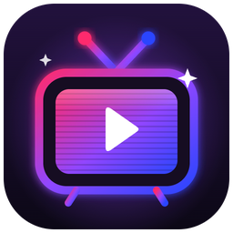</p>
<h1 align="center">Vibe TV</h1>
<p align="center"><b>Your stream's alerts, on the TV behind you.</b><br>
Raids, shoutouts, subs, bits, watch streaks, modiversaries and giant emotes take over the screen on your wall, with Twitch clips and room lights to match.</p>
<p align="center"><i>Because a raid deserves more than a corner of an overlay.</i></p>
<p align="center">
  <a href="https://github.com/TTV-VibesByVince/Vibes-TV/releases"></a>
  <a href="https://github.com/TTV-VibesByVince/Vibes-TV/actions/workflows/tests.yml"></a>
  <a href="https://github.com/TTV-VibesByVince/Vibes-TV/actions/workflows/docker.yml"></a>
  <a href="https://github.com/TTV-VibesByVince/Vibes-TV/pkgs/container/vibes-tv"></a>
  
  
  <a href="LICENSE"></a>
</p>

<p align="center"><a href="docs/vibe-tv-demo.mp4">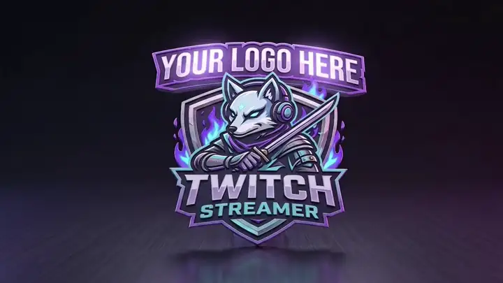</a></p>
<p align="center"><sub>A placeholder logo and made-up channel names; everything else is exactly what the TV shows. <a href="docs/vibe-tv-demo.mp4">Full-quality video</a> (22 s, silent).</sub></p>

Vibe TV is a small web server that runs in Docker on a NAS or any always-on machine. Your TV opens one web page and loops your logo. When [MixItUp](https://mixitupapp.com) (or anything that can send a web request) reports a raid, shoutout, follow, sub, bits, gifted subs, a watch streak, a modiversary or a gigantified emote, that screen takes over: their profile picture, their name, an animation, then one of their Twitch clips. Your room lights can switch to the colour of their picture. The same alerts can also play on your stream, as a transparent [OBS overlay](docs/overlay.md) with its own queue, and [TikTok LIVE](docs/tiktok.md) follows, subs and gifts can join in, with TikTok chat [read aloud](docs/tts.md). Everything is set up from a settings page in your browser.

> [!NOTE]
> You need a machine that runs Docker all the time (a NAS, mini PC or Raspberry Pi 4/5), a TV with a web browser, and MixItUp or a similar bot to send the events.

<table>
  <tr>
    <td width="50%" valign="top">
      <h3>Setting it up?</h3>
      Three steps in Portainer, then point the TV at one address. No coding, no building.<br><br>
      <a href="#quick-start"><b>Quick start</b></a> · <a href="docs/install.md">Install guide</a> · <a href="docs/tv.md">The TV</a> · <a href="docs/mixitup.md">MixItUp URLs</a> · <a href="docs/overlay.md">OBS overlay</a>
    </td>
    <td width="50%" valign="top">
      <h3>Making it yours?</h3>
      Change every word on screen, each event's colour, seasonal themes and light effects, all from the settings page.<br><br>
      <a href="docs/customize.md"><b>Text, colours and themes</b></a> · <a href="docs/lights.md">Lights</a> · <a href="#faq">FAQ</a>
    </td>
  </tr>
</table>

## Quick start

1. **Run it.** In Portainer: **Stacks > Add stack**, paste this, change the folder paths and your timezone, **Deploy**.

   ```yaml
   services:
     vibe-tv:
       image: ghcr.io/ttv-vibesbyvince/vibes-tv:latest
       container_name: vibe-tv
       restart: unless-stopped
       ports:
         - "8777:8777"
       environment:
         - TZ=America/New_York
       volumes:
         - /volume1/docker/vibe-tv/media:/media
         - /volume1/docker/vibe-tv/config:/config
         - /volume1/docker/vibe-tv/cache:/cache
   ```

2. **Set it up.** Open `http://<server-ip>:8777/admin`: upload your logo, and (optionally) add [Twitch API keys](docs/install.md#twitch-api-keys-optional-recommended) for pictures, games and clips.
3. **Show it.** On the TV, open `http://<server-ip>:8777/tv` full screen ([Fully Kiosk Browser setup](docs/tv.md)), and copy the event URLs from the settings page into MixItUp.

Synology Container Manager, plain Docker Compose and updating: [install guide](docs/install.md).

## A look around

<table>
  <tr>
    <td width="50%">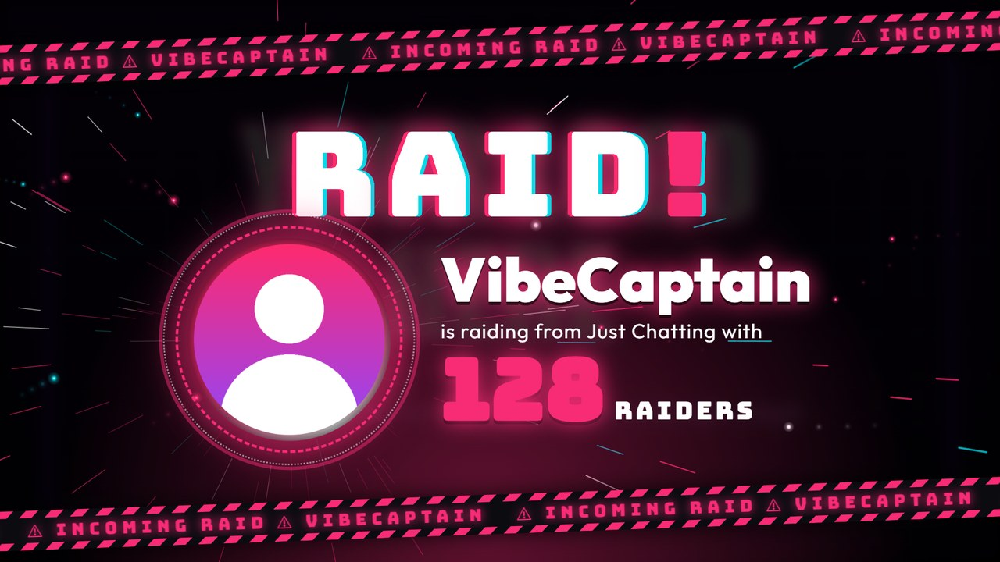<br><sub><b>Raid</b>: one glowing dot flies in for every raider</sub></td>
    <td width="50%">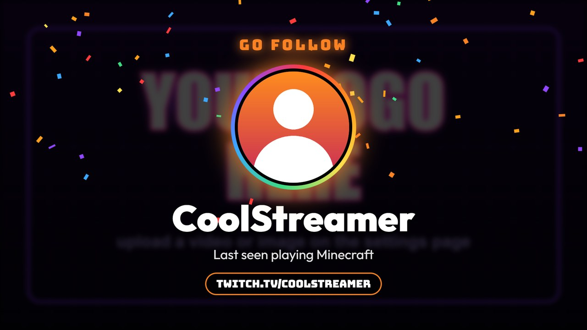<br><sub><b>Shoutout</b>, then a clip from their channel</sub></td>
  </tr>
  <tr>
    <td>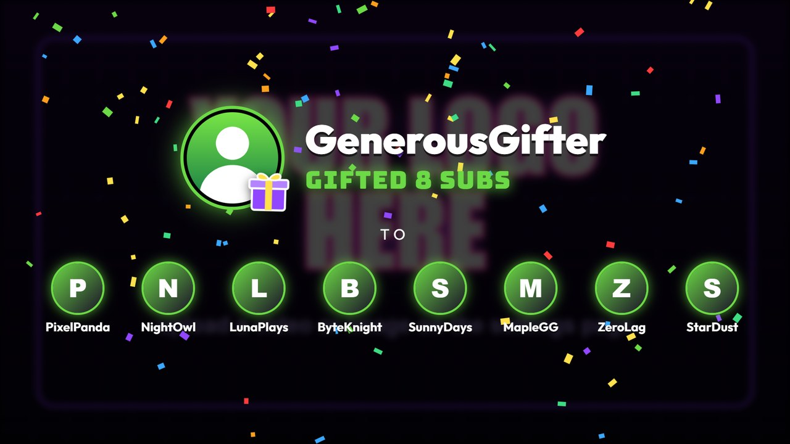<br><sub><b>Gifted subs</b>: the gifter and everyone who got one</sub></td>
    <td>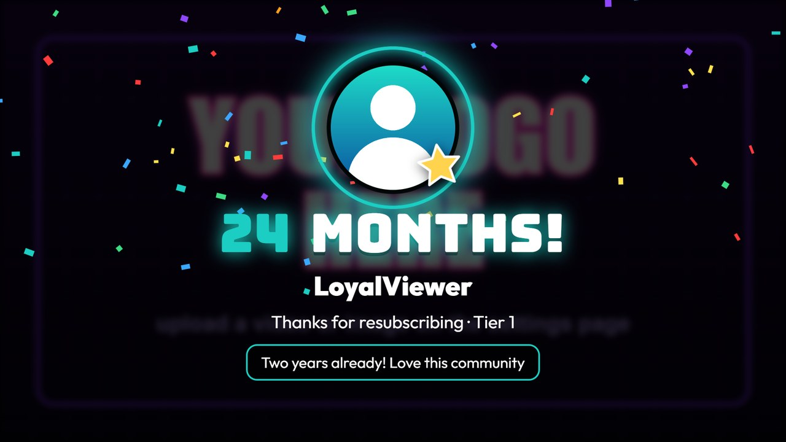<br><sub><b>Resub</b> with the month count and their message</sub></td>
  </tr>
  <tr>
    <td>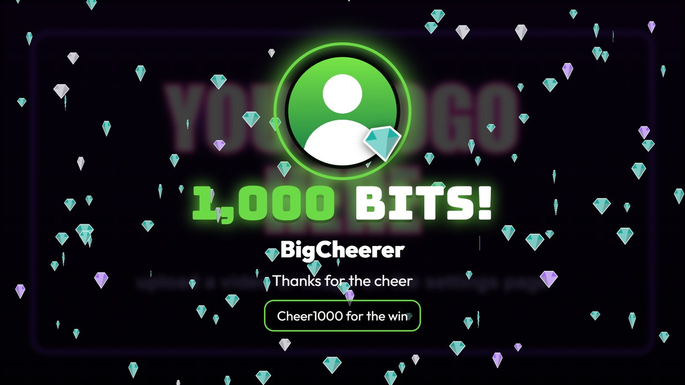<br><sub><b>Bits</b>: gems rain in Twitch's cheer colours</sub></td>
    <td>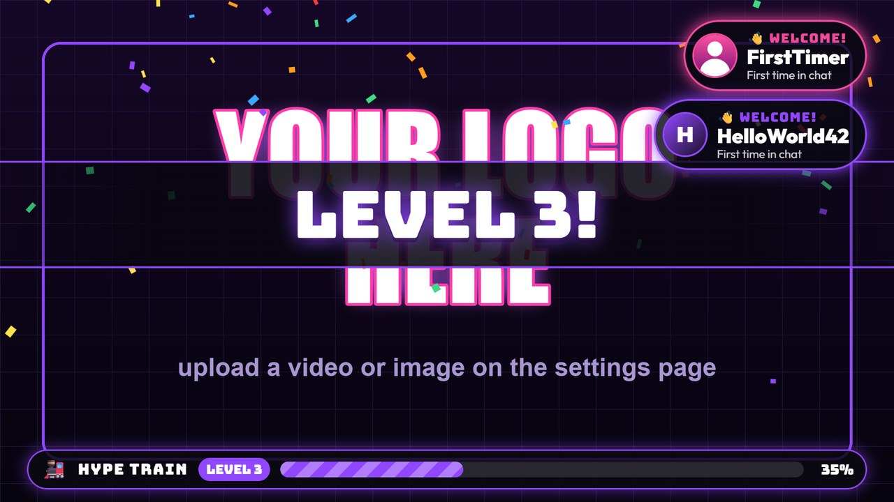<br><sub><b>Hype train</b> bar and level-up banners, plus <b>welcome</b> pop-ups for first-time chatters</sub></td>
  </tr>
  <tr>
    <td><br><sub><b>Tier 3 sub</b>: spotlights, a crown and gold rain (Tier 2 gets its own bigger card too)</sub></td>
    <td>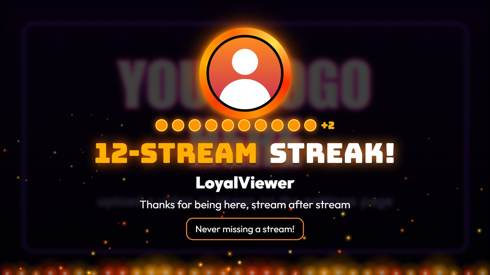<br><sub><b>Watch streak</b>: a fuse of dots and a bed of fire</sub></td>
  </tr>
  <tr>
    <td>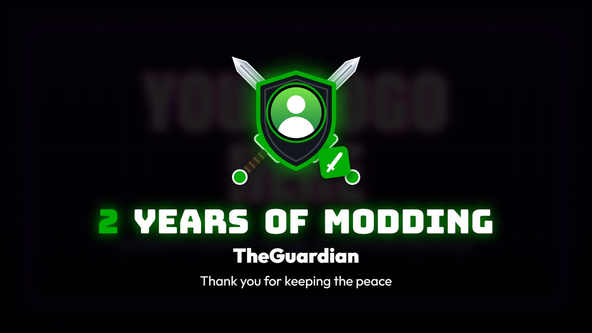<br><sub><b>Modiversary</b>: a sword slash, then crossed swords</sub></td>
    <td>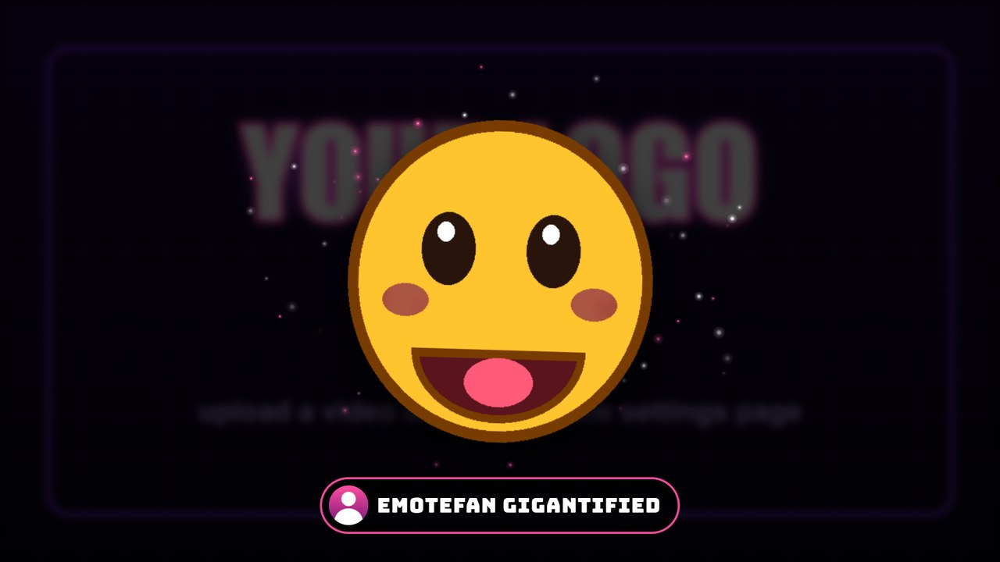<br><sub><b>Gigantified emote</b>, huge on the TV (a made-up emote here)</sub></td>
  </tr>
  <tr>
    <td>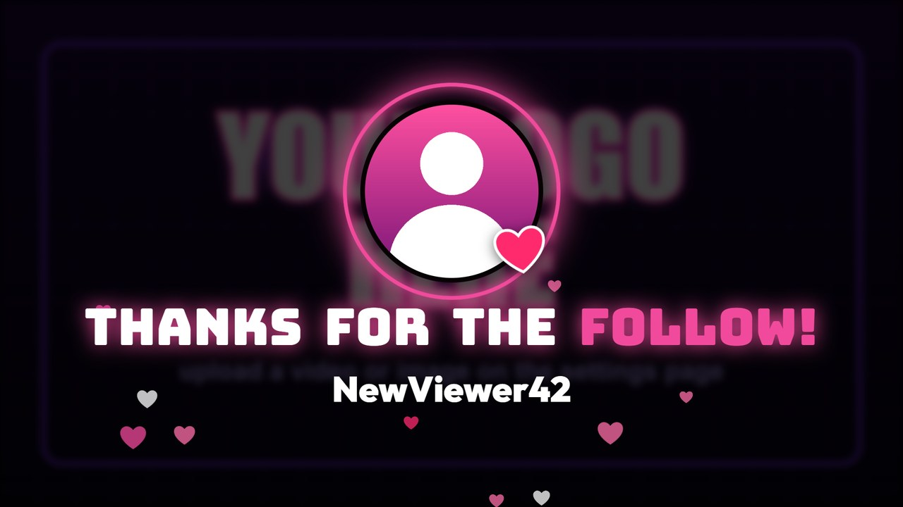<br><sub><b>Follow</b> and <b>sub</b> cards</sub></td>
    <td>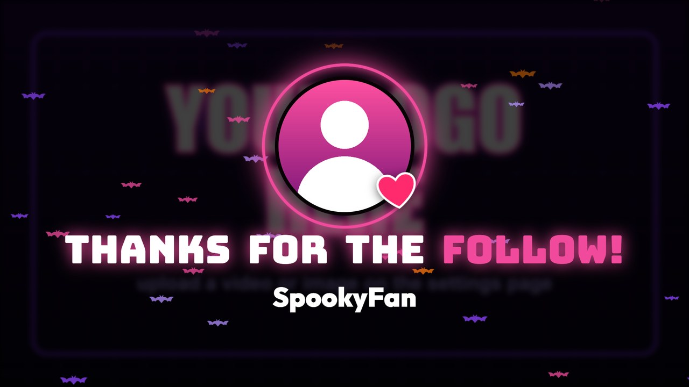<br><sub><b>Themes</b>: Halloween bats, holiday snow, St Patrick's clovers</sub></td>
  </tr>
</table>

<p align="center">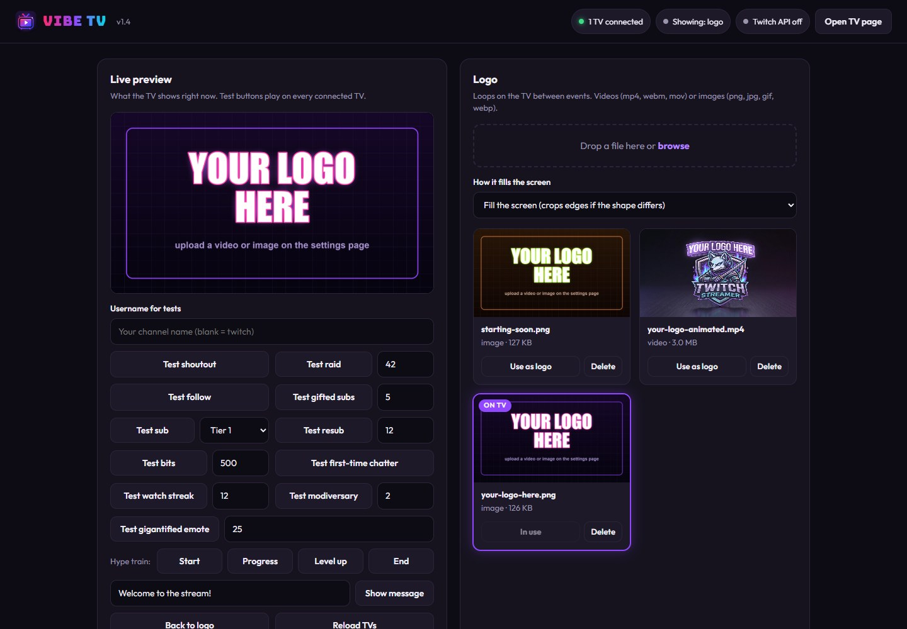<br><sub>The <b>settings page</b>: a live preview, a test button for every event, your logo library. <a href="docs/screenshots/settings-full.jpg">See all of it</a>.</sub></p>

<sub>Screenshots use a placeholder logo and made-up channel names.</sub>

## Features

**Screens.** Shoutouts (picture, last game, `twitch.tv/` link). Raids (hazard tape, slamming title, a portal, warp streaks, one glowing dot per raider and a count-up). Follows. Subs and resubs (month count and their message), bigger for Tier 2 and biggest for Tier 3. Bits (gems in Twitch's cheer colours). Watch streaks. Modiversaries (swords!). Gigantified emotes, giant on the TV. Gifted subs (one-at-a-time gift events are combined into one screen with every recipient). Messages from chat commands. Events queue up and play one after another.

**Alongside everything.** First-time chatters get a small "Welcome!" pop-up in the corner that never interrupts. A hype train shows a progress bar along the bottom, with banners when it starts, levels up and ends.

**On stream too.** A transparent [stream overlay](docs/overlay.md) for OBS shows the same alerts, with its own queue, so it never waits for a TV clip. For each alert type, choose where it plays (TV, overlay or both) and how big it is on stream: a compact card in your corner, a bigger card in the centre, or the TV's full-screen animation over your game with the stream darkened behind it (raids, by default). Optional [TikTok LIVE](docs/tiktok.md) alerts: follows, subscriptions and gifts (combos shown once, with the total). Optional [text to speech](docs/tts.md) reads TikTok chat (or a MixItUp `!tts` command) aloud in a Microsoft Edge voice, one message at a time, with filters against trolls.

**Clips and lights.** After a shoutout or raid it can play one of that streamer's most-viewed Twitch clips, buffered while their card is on screen. Your room lights can follow each event's colour (for example with [Govee Lights Controller](https://github.com/TTV-VibesByVince/Govee-Lights-Controller)) and go back to normal afterwards.

**Make it yours.** Every word on every screen is editable, with `{name}`, `{months}`, `{amount}` and so on filled in. Each event's colour comes from the avatar, the theme or a colour you pick. Themes (Halloween, Winter holidays, Valentine's, St Patrick's) switch in one click or by date, every year. Back up and restore all settings in one file.

**Under the hood.** One small Python server (aiohttp) and three web pages (TV, overlay, settings), no database. The image is built by GitHub for Intel/AMD and ARM, and rebuilt weekly with the newest yt-dlp. Fonts are bundled, so the TV page works without internet. Lite mode keeps animations smooth on TV sticks and smart TVs. Optional password for the settings page.

## Status: 1.7

> [!IMPORTANT]
> Vibe TV is young. It works and it's tested, but it is a hobby project made for one channel first, so expect rough edges. The [changelog](CHANGELOG.md) lists what changed in each version.

- **Running for real** on a NAS with Portainer, shown on an Android TV with Fully Kiosk Browser.
- **Tested automatically on every change** ([tests](tests/)): settings, every MixItUp URL, gift batching, the hype train, themes and the date schedule, backup and restore (including older backups), uploads, the settings password, the calls to your lights, the TV and overlay queues running independently, routing, TikTok events, text to speech and its filters, and unfilled MixItUp variables.
- **Checked by hand and by screenshots**: every animation in full and lite mode on the TV and on the overlay (over a coloured background, to check it's really transparent), the settings page, Twitch lookups and clips.
- **Known gaps**: the settings page's MixItUp URLs use MixItUp's variable names from its documentation; if your version names one differently, **Settings > Last requests received** shows what actually arrived, and an unfilled variable is ignored instead of shown ([MixItUp URLs](docs/mixitup.md)). No alert sounds yet, and it needs a bot like MixItUp to report Twitch events (it doesn't connect to Twitch by itself). TikTok LIVE and text to speech use unofficial libraries, so they can break for a while when TikTok or Microsoft change things. See the [roadmap](ROADMAP.md).

## FAQ

<details>
<summary><b>NAS, other bots, OBS, Twitch keys and more</b></summary>

**Do I need a NAS?** No. Any machine that runs Docker and stays on works: a mini PC, a Raspberry Pi 4 or 5, a home server. Your streaming PC works too (Docker Desktop), but then the TV only works while that PC is on.

**Does it work with Streamer.bot, SAMMI or something else?** Yes. Vibe TV only needs a web request (GET) to a URL, so any bot or tool that can open a URL works. The URLs are the same as for MixItUp.

**Can I put it in OBS?** Yes. Add `http://<server-ip>:8777/overlay` as a Browser Source (1920 x 1080, no custom CSS). It's transparent, shows nothing between alerts, and plays each alert as a small card in the corner you pick, a bigger one in the centre, or full screen like the TV (raids, by default), with its own queue so it never waits for the TV. Choose which alerts go to the TV, the overlay or both under **Settings > Stream overlay**. Clips stay on the TV by default, so their sound doesn't play twice. See [Stream overlay](docs/overlay.md).

**Does it work with TikTok?** Optionally, for TikTok LIVE follows, subscriptions and gifts, through the unofficial open source [TikTokLive](https://github.com/isaackogan/TikTokLive) library. Switch it on under **Settings > TikTok LIVE** with your username. See [TikTok LIVE](docs/tiktok.md).

**Can it read chat aloud?** Yes: TikTok LIVE chat, and anything MixItUp sends to `/tts` (a `!tts` command, for example), in a Microsoft Edge voice of your choice, on the stream overlay. Switch it on under **Settings > Text to speech**. See [Text to speech](docs/tts.md).

**Do I need Twitch API keys?** No. Without them, names show as typed and pictures come from `&avatar=` on the URL (or a big initial). With them you get real display names, profile pictures, the last game played, pictures for gift recipients, and clips.

**Does it need the internet?** Only to look things up on Twitch, download clips and fetch profile pictures. The TV page itself, fonts included, comes from your server.

**Can I have more than one TV?** Yes. Every screen that opens `/tv` shows the same thing at the same time. One TV can force lite or full mode with `/tv?mode=lite`.

**Where are my settings?** In `config/settings.json` on the server, and your logos are in `media/`. Updating keeps both. **Settings > Backup** saves everything in one file.

**Can I open it to the internet?** It's built for your home network: anyone who can reach the event URLs can trigger screens. Keep it behind your router, and set a password for the settings page. See [SECURITY.md](SECURITY.md).

</details>

## Troubleshooting

- **A small red dot in the bottom-right corner of the TV**: the TV lost its connection to the server. It reconnects by itself; if it stays, check the container is running and the TV can reach `http://<server-ip>:8777/status`.
- **Black screen instead of the logo**: upload a logo on the settings page, and in Fully Kiosk turn on **Autoplay Videos** ([The TV](docs/tv.md)).
- **MixItUp says "bad username" or nothing happens**: a variable in the URL came through empty or wrong. Try the URL in a browser with a real name, then check the variable names in MixItUp's event editor.
- **Lights don't change**: the light URLs must use the PC's address, not the server's. The **Last light call** box on the settings page shows the exact error. More in [Lights](docs/lights.md).
- **Clips don't play**: check **Settings > Twitch API > Test connection**, and that the streamer has clips shorter than **Longest clip**. Pulling the latest image updates the clip downloader.
- **Animations are choppy on the TV**: set **Timing > TV animation quality** to **Lite**.
- **A gigantified emote shows as text, or a Tier 3 sub shows as Tier 1**: MixItUp sent something Vibe TV couldn't use. **Settings > Last requests received** shows the exact URL; see [MixItUp URLs](docs/mixitup.md) for what each option accepts.
- **The settings page asks for a password**: `ADMIN_PASSWORD` is set on the container. Any user name works.

Still stuck? [Open an issue](https://github.com/TTV-VibesByVince/Vibes-TV/issues/new/choose) with the version (top of the settings page), your TV and browser, and what you expected to see.

## Docs

| | |
| --- | --- |
| [Install and update](docs/install.md) | Portainer, Synology, Docker Compose, Twitch keys, password, updating |
| [The TV](docs/tv.md) | Fully Kiosk Browser, other browsers, lite mode |
| [MixItUp URLs](docs/mixitup.md) | Every URL and option |
| [Stream overlay](docs/overlay.md) | The alerts on your stream: OBS setup, position, size, routing |
| [TikTok LIVE](docs/tiktok.md) | TikTok follows, subscriptions and gifts (optional) |
| [Text to speech](docs/tts.md) | TikTok chat and `/tts` read aloud with Edge voices (optional) |
| [Lights](docs/lights.md) | Room lights that follow each event |
| [Make it yours](docs/customize.md) | Text, colours, themes, schedule, backup |

## Roadmap, contributing and security

What's next is in the [roadmap](ROADMAP.md), and what changed is in the [changelog](CHANGELOG.md). Ideas and bug reports are welcome as [issues](https://github.com/TTV-VibesByVince/Vibes-TV/issues); to work on the code, see [CONTRIBUTING.md](CONTRIBUTING.md). Found a security problem? Please follow [SECURITY.md](SECURITY.md) instead of opening a public issue.

## License and credits

[MIT](LICENSE). The bundled fonts, [Bungee](https://fonts.google.com/specimen/Bungee) and [Outfit](https://fonts.google.com/specimen/Outfit), are under the SIL Open Font License 1.1 (see `app/static/fonts`). Clips are downloaded with [yt-dlp](https://github.com/yt-dlp/yt-dlp). TikTok LIVE events come from [TikTokLive](https://github.com/isaackogan/TikTokLive) (AGPL-3.0 with an added permission for overlays and bots; installed from PyPI, not bundled). Text to speech uses [edge-tts](https://github.com/rany2/edge-tts) (LGPL-3.0, installed from PyPI, not bundled). Made by [VibesByVince](https://github.com/TTV-VibesByVince).
