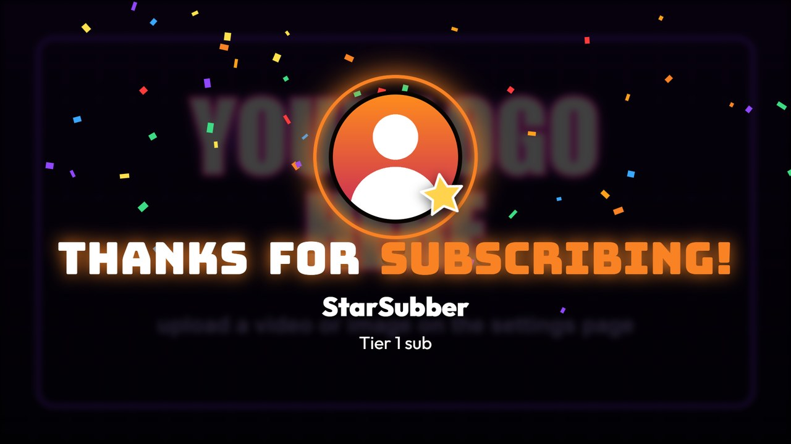
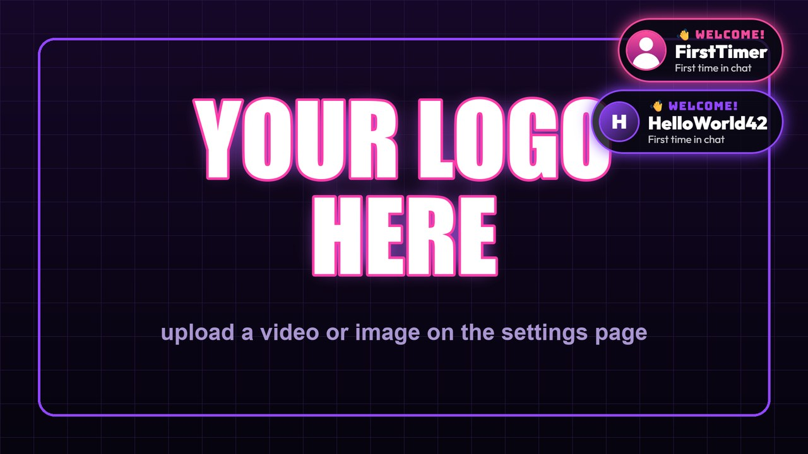
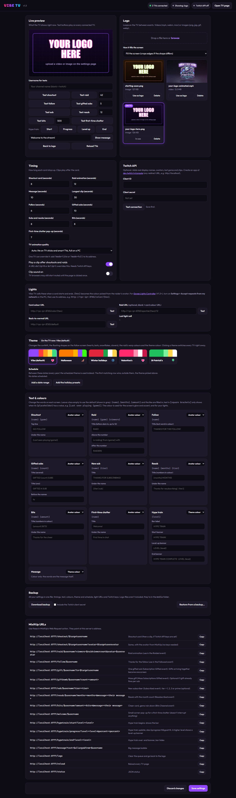

# Vibe TV

A stream TV for the wall behind you. It loops your logo, and when
[MixItUp](https://mixitupapp.com) sends a web request it shows a shoutout,
raid, follow, sub, resub, bits or gifted-sub screen, welcomes first-time
chatters and tracks hype trains. It can play one of that streamer's Twitch
clips, and set your room lights to the colour of their profile picture.

It runs in Docker (a NAS is ideal). The TV just opens a web page, and
everything is set up from a settings page in the browser.

## See it in action

[](docs/vibe-tv-demo.mp4)

This is an example of what can play on the TV in the background of your
stream. Your logo loops (a video or an image) until something happens: here
a raid comes in, the screen takes over with the raid animation, then it goes
back to the logo until gifted subs arrive.

You can also have it **play a clip from that person's channel** after a
shoutout or a raid. It picks one of their most-viewed Twitch clips and plays
it full screen right after their card, so your viewers get a taste of their
stream (needs [Twitch API keys](#twitch-api-keys-optional-recommended)).

[▶ Watch the full-quality video](docs/vibe-tv-demo.mp4) (22 seconds, silent)

### Screenshots

| Raid | Shoutout |
| --- | --- |
|  |  |

| Follow | Gifted subs |
| --- | --- |
|  |  |

| New sub | Resub |
| --- | --- |
|  |  |

| Bits | First-time chatters |
| --- | --- |
|  |  |

| Hype train | Halloween theme |
| --- | --- |
|  |  |

### Settings page


<details>
<summary>Full settings page</summary>



</details>

*Screenshots use a placeholder logo and made-up channel names.*

## Features

- **Shoutouts**: avatar, name, last game and a `twitch.tv/` link, then a
  random clip from their most-viewed clips.
- **Raids**: a full-screen animation with hazard tape, a slamming RAID! title,
  a portal around the raider's avatar, warp streaks, one glowing dot per
  raider flying in, and a count-up. Then a clip.
- **Follows**: "Thanks for the follow!" with their picture and floating hearts.
- **Gifted subs**: the gifter, then every recipient's picture and name.
  One-at-a-time gift events from MixItUp are combined into one screen.
- **Subs and resubs**: a star badge and confetti; resubs show the month
  count big, plus their resub message.
- **Bits**: gems rain down in Twitch's cheer colours (grey, purple, teal,
  blue, red by amount), with the amount and their message.
- **First-time chatters**: a small "Welcome!" pop-up in the corner that
  doesn't interrupt whatever is on screen.
- **Hype train**: a progress bar along the bottom that fills as it goes,
  with banners when it starts, levels up and ends.
- **Messages**: a big text bubble for chat commands.
- **Your words**: every line of text on every screen can be changed, with
  `{name}`, `{months}`, `{amount}` and so on filled in.
- **Your colours**: each event uses the avatar's colour, the theme's colour,
  or one you pick. Your lights follow it.
- **Themes**: Halloween (bats, orange), Winter holidays (snowflakes),
  Valentine's, St Patrick's (clovers). Switch in one click, or schedule
  them by date so they turn on and off by themselves.
- **Backup and restore** of all settings in one file.
- **Logo library**: upload videos or images, pick which one loops.
- **Light sync**: calls your light controller with the avatar's colour,
  e.g. [Govee Lights Controller](https://github.com/TTV-VibesByVince/Govee-Lights-Controller)
  V1.3+, or anything that takes a colour in a URL.
- **Lite mode** for TV sticks and smart-TV browsers (Fully Kiosk etc.).
- A live preview and test buttons for every event on the settings page.
- Events queue up and play one after another.
- Everything is self-contained: fonts are bundled, so the TV page doesn't
  need the internet (only Twitch lookups and clips do).

## Install

You need a machine that runs Docker all the time (a NAS, a mini PC, a
Raspberry Pi 4/5) on the same network as the TV and the PC running MixItUp.

### Portainer

1. Download this repository as a ZIP (green **Code** button > Download ZIP),
   unzip it, and make a `.tar` of the build files. In PowerShell, inside the
   unzipped folder, run:
   `tar -cf vibe-tv.tar Dockerfile requirements.txt app`
2. **Images > Build a new image**: name `vibe-tv:latest`, method **Upload**,
   select `vibe-tv.tar`, then **Build the image**.
3. **Stacks > Add stack**, name `vibe-tv`, **Web editor**, paste this, and
   change the folder paths on the left to a folder on your server:

   ```yaml
   services:
     vibe-tv:
       image: vibe-tv:latest
       container_name: vibe-tv
       restart: unless-stopped
       ports:
         - "8777:8777"
       environment:
         - TZ=Etc/UTC
         - ADMIN_PASSWORD=
       volumes:
         - /volume1/docker/vibe-tv/media:/media
         - /volume1/docker/vibe-tv/config:/config
         - /volume1/docker/vibe-tv/cache:/cache
   ```

4. **Deploy the stack**.

### Synology Container Manager (or plain Docker Compose)

1. Copy this folder to the server, e.g. `/volume1/docker/vibe-tv`.
2. Container Manager > **Project** > **Create**, choose that folder; it finds
   `docker-compose.yml`. Anywhere else: `docker compose up -d --build`.

### Then

1. Open `http://<server-ip>:8777/admin` and upload your logo.
2. On the TV, open `http://<server-ip>:8777/tv` full screen (see
   [The TV](#the-tv-fully-kiosk-browser) below).
3. If the server has a firewall, allow TCP 8777 from your home network.

## The TV: Fully Kiosk Browser

The TV page is an ordinary web page, so any modern browser shown full
screen works. We use **[Fully Kiosk Browser](https://www.fully-kiosk.com)**
on an Android-based TV. It's built for screens that stay on all day: it
opens one page full screen, keeps it there, survives restarts, and plays
video without anyone touching a remote. It runs on Android TV, Google TV,
Fire TV sticks and Android boxes (Google Play or the Amazon Appstore). The
free version is enough for Vibe TV.

Setup (menu names can differ a little between versions):

1. Install Fully Kiosk Browser on the TV and open it.
2. **Start URL**: `http://<server-ip>:8777/tv`
3. **Web Content Settings > Autoplay Videos**: on. Needed for the logo
   loop and clips, and for clip sound if you turn sound on.
4. **Device Management > Keep Screen On**: on.
5. **Device Management > Launch on Boot**: on, so the TV comes back to
   Vibe TV after a power cut or restart.
6. Hide the status and navigation bars (full screen) under
   **Toolbars & Appearance**.

Tips:

- TV-stick graphics chips are much weaker than a PC's. Vibe TV detects
  Fully Kiosk and other TV browsers and switches to **lite mode**
  automatically (see [Slow TVs](#slow-tvs)).
- A small red dot in the bottom-right corner means the TV has lost its
  connection to the server. It reconnects by itself.
- Changed something? **Reload TVs** on the settings page refreshes every TV
  without touching the remote.

Other options: Chrome or Edge on a PC or mini PC (press F11), or Chromium on
a Raspberry Pi started with `--kiosk http://<server-ip>:8777/tv`. Built-in
smart-TV browsers and Amazon Silk work too, but often won't autoplay video
or stay full screen.

## MixItUp

Add **one Web Request action (GET) per event**, pointing at Vibe TV. The
settings page lists these with copy buttons, already filled in with your
server's address.

| MixItUp event / command | URL |
| --- | --- |
| Shoutout command | `/shoutout/$targetusername` |
| Channel Raided | `/raid/$username?viewers=<raid viewer count>` |
| Followed | `/follow/$username` |
| Subscription Gifted | `/gift/$username?to=$targetusername` |
| Mass Subscriptions Gifted (optional) | `/giftbomb/$username?count=<amount>` |
| Subscribed | `/sub/$username?tier=<tier>` |
| Resubscribed | `/resub/$username?months=<months>&message=<message>` |
| Bits Cheered | `/bits/$username?amount=<bits>&message=<message>` |
| First chat message | `/welcome/$username` |
| Hype Train Start | `/hypetrain/start?level=<level>` |
| Hype Train progress / Level Up | `/hypetrain/progress?level=<level>&percent=<percent>` |
| Hype Train End | `/hypetrain/end?level=<level>` |
| A chat command | `/message?text=$allargs&from=$username` |
| | `/logo`: clear the queue and the hype bar, back to the logo |
| | `/reload`: reload every TV page |
| | `/status`: JSON status |

Words in `<angle brackets>` are MixItUp's special identifiers for that
event; pick the matching ones in MixItUp's event editor (the names vary by
event and version). Everything after `?` is optional except the bits
`amount`:

- Shoutout and raid: `&clip=0|1`, `&sound=0|1`, `&display=Name`,
  `&game=Game`, `&avatar=<picture link>`.
- Sub and resub `tier`: `1`, `2`, `3`, `prime`, or Twitch's `1000/2000/3000`.
- Hype train: `percent=` (0 to 100), or `progress=` and `goal=` as numbers.
  A higher `level` than last time shows a level-up banner. If no update
  arrives for 6 minutes, the bar hides by itself.
- `/welcome` shows straight away in the corner, even over another screen;
  everything else waits its turn in the queue.

## Twitch API keys (optional, recommended)

These add real display names, avatars, last game and clips. Without them,
cards show the name as typed and an initial instead of a picture (unless
MixItUp sends `&avatar=`).

1. [dev.twitch.tv/console/apps](https://dev.twitch.tv/console/apps) >
   **Register Your Application**. OAuth Redirect URL: `http://localhost`,
   Category: Other, Client type: Confidential.
2. Copy the **Client ID**, click **New Secret**, copy that too.
3. Paste both into the settings page > Twitch API, **Save**, then
   **Test connection**.

## Lights

Vibe TV calls your lights itself: **don't** add light URLs to MixItUp.

1. When a card starts, it picks the strongest colour from the person's
   profile picture and calls the **Card colour URL** with `{hex}` replaced
   by it (e.g. `ff7800`).
2. The lights stay that colour through the card and the clip.
3. When the TV goes back to the logo, it calls the **Back-to-normal URL**.

The **Raid URL** (optional) is used instead of the card colour for raids,
e.g. a sparkle effect in the raider's colour.

### With Govee Lights Controller

[Govee Lights Controller](https://github.com/TTV-VibesByVince/Govee-Lights-Controller)
is our companion Windows app for Govee lights. Using V1.3 or newer, on the
PC running it turn on **Settings > Accept requests from my network**, save
and restart it. Then use the **PC's** address (not the server's):

- Card colour URL: `http://<pc-ip>:8765/color/{hex}`
- Raid URL: `http://<pc-ip>:8765/sparkle/{hex}/12`
- Back-to-normal URL: `http://<pc-ip>:8765/default`

The Test buttons always send purple (`9146ff`); real events use the avatar
colour. Give the PC a fixed address (a DHCP reservation in your router) so
the URLs keep working.

## Make it yours

### Text

Settings > **Text & colours** has a box for every line on every screen.
Leave a box empty to keep the default. Placeholders like `{name}`,
`{months}`, `{amount}`, `{tier}`, `{count}`, `{viewers}`, `{game}` and
`{level}` are filled in (each event lists the ones it has). Text in
`[square brackets]` only shows when its placeholder has a value, so
`[Last seen playing {game}]` disappears for someone with no game.

### Colours

Each event's colour drives its glow, accents and your lights:

- **Avatar colour** (default): picked from their profile picture.
- **Theme colour**: the current theme's colour (e.g. orange at Halloween).
- **Custom**: any colour you choose.

### Themes

Settings > **Theme**. A theme changes the confetti, the shapes that float up
on the follow screen, the raid's warp colours and the theme colour.

| Theme | Floats | Colour |
| --- | --- | --- |
| Vibe (default) | hearts | purple |
| Halloween | bats | orange |
| Winter holidays | snowflakes | red |
| Valentine's | hearts | pink |
| St Patrick's | clovers | green |

Click one to switch every TV at once. Under **Schedule**, add date ranges
(they repeat every year) and the theme turns itself on and off; **Add the
holiday presets** fills in sensible dates. A scheduled theme beats the one
you clicked while its dates last.

### Backup

Settings > **Backup** downloads every setting in one JSON file (the Twitch
secret only if you tick the box) and restores it again, e.g. after
reinstalling. Logo files aren't in it: they live in the `media` folder.

## Slow TVs

Settings > Timing > **TV animation quality**. *Auto* (the default) uses lite
mode on TV sticks, smart TVs and Android boxes such as Fully Kiosk Browser,
and full mode on a PC. Lite keeps the same animations but drops what weak
graphics chips struggle with (blurring the playing logo, soft glows,
animated filters) and draws particles at half resolution. Force it for one
TV with `/tv?mode=lite` or `/tv?mode=full`.

## Settings page password

Set `ADMIN_PASSWORD` to protect `/admin` (the browser asks for a user name
and password; the user name can be anything). The TV page and the MixItUp
URLs stay open on your network.

## Updating

Rebuild the image from the new files (Portainer: **Images > Build** with the
same name, then **Containers > vibe-tv > Recreate**). Your logos and
settings live in the `media` and `config` folders and are kept. Rebuilding
also updates yt-dlp, which fixes most "clips stopped working" problems.

## License

[MIT](LICENSE). The bundled fonts, [Bungee](https://fonts.google.com/specimen/Bungee)
and [Outfit](https://fonts.google.com/specimen/Outfit), are under the SIL
Open Font License 1.1 (see `app/static/fonts`).
