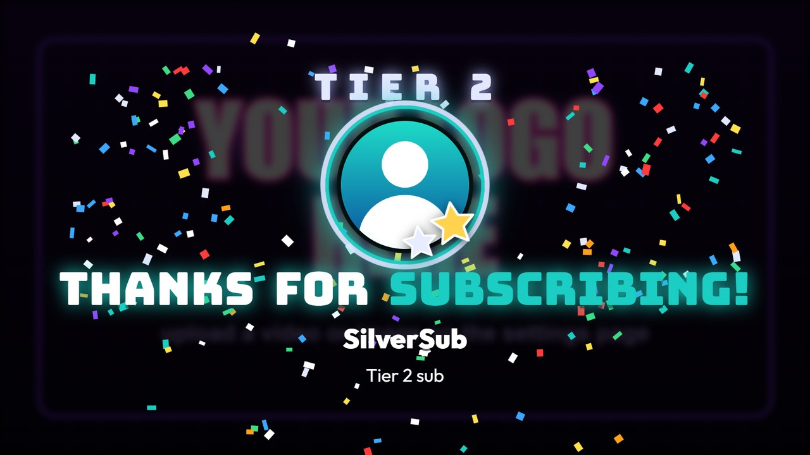
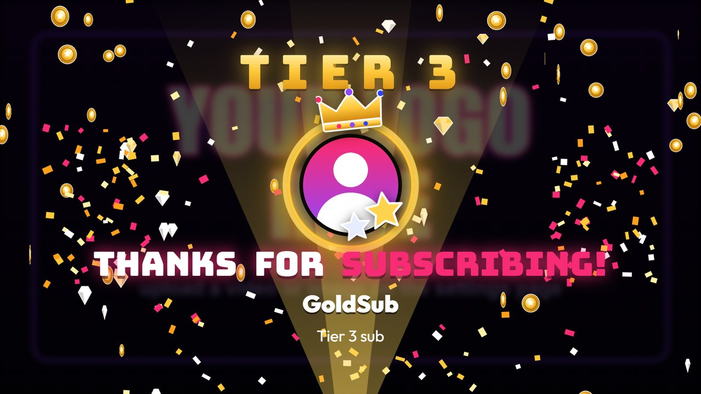

# MixItUp URLs

[← Back to the README](../README.md) · [All docs](README.md)

Add **one Web Request action (GET) per event**, pointing at Vibe TV. The
settings page lists these with copy buttons, already filled in with your
server's address.

| MixItUp event / command | URL |
| --- | --- |
| Shoutout command | `/shoutout/$targetusername` |
| Channel Raided | `/raid/$username?viewers=$raidviewercount` |
| Followed | `/follow/$username` |
| Subscription Gifted | `/gift/$username?to=$targetusername` |
| Mass Subscriptions Gifted (optional) | `/giftbomb/$username?count=$subsgiftedamount` |
| Subscribed | `/sub/$username?tier=$usersubplan` |
| Resubscribed | `/resub/$username?months=$usersubmonths&tier=$usersubplan&message=$message` |
| Bits Cheered | `/bits/$username?amount=$bitsamount&message=$messagenocheermotes` |
| Watch Streak | `/streak/$username?count=$userwatchstreak&message=$message` |
| Modiversary | `/modiversary/$username?months=$usermodiversarymonths` |
| Power-Up Gigantified Emote | `/gigantify/$username?emote=$emoteurl&name=$emotename` |
| First chat message | `/welcome/$username` |
| Hype Train Start | `/hypetrain/start?level=$hypetrainlevel&progress=$hypetrainlevelpoints&goal=$hypetrainlevelgoal` |
| Hype Train Progress / Level Up | `/hypetrain/progress?level=$hypetrainlevel&progress=$hypetrainlevelpoints&goal=$hypetrainlevelgoal` |
| Hype Train End | `/hypetrain/end?level=$hypetraintotallevel` |
| A chat command | `/message?text=$allargs&from=$username` |
| A chat command (read aloud) | `/tts?text=$allargs&from=$username` |
| | `/tts/skip`: stop what's being read aloud |
| | `/logo`: clear the queues and the hype bar: the TV goes back to the logo, the overlay goes empty. `/logo?screen=tv` or `/logo?screen=overlay` clears just one |
| | `/reload`: reload every TV and overlay page |
| | `/status`: JSON status |

The `$words` are MixItUp's special identifiers for each event (from
[MixItUp's Twitch event list](https://mixitup.bot/docs/platforms/twitch)).
Type them exactly as shown: MixItUp fills them in when the event happens.
The settings page lists the same URLs with copy buttons, already filled in
with your server's address. Everything after `?` is optional except the
bits `amount` and the gigantified `emote`. If a variable reaches Vibe TV
unfilled (still `$emoteurl`, or a `<placeholder>`), it's ignored instead of
shown on screen, and **Last requests received** says so.

- Shoutout and raid: `&clip=0|1`, `&sound=0|1`, `&display=Name`,
  `&game=Game`, `&avatar=<picture link>`.
- Sub and resub `tier`: MixItUp's `$usersubplan` (`Prime`, `Tier 1`, `Tier 2`,
  `Tier 3`), or `1`, `2`, `3`, `prime`, or Twitch's `1000/2000/3000`.
  **Tier 2** gets a bigger card (two stars, confetti cannons, a short shake) and **Tier 3** the biggest (spotlights, a gold
  crown, coins raining). If MixItUp has no tier variable for your event, use
  separate URLs instead: `/sub/$username/tier2` and `/sub/$username/tier3`,
  picked with a condition in MixItUp.
- Hype train: `percent=` (0 to 100), or `progress=` and `goal=` as numbers.
  A higher `level` than last time shows a level-up banner. If no update
  arrives for 6 minutes, the bar hides by itself.
- Modiversary: `years=` or `months=` (18 months shows as "18 MONTHS", 24 as
  "2 YEARS"). It uses Twitch's mod green unless you pick another colour.
- Gigantified emote `emote=`: an **image link** (MixItUp's `$emoteurl`) or an
  **emote ID** (like `emotesv2_…` or `25`) always works, for any emote. A
  Twitch emote link is switched to the biggest size, animated when the emote
  is. `&name=` (MixItUp's `$emotename`) adds the emote's name to the caption.
  An emote **name** on its own (like `LUL`) is looked up on Twitch: global
  emotes, and your own channel's if you enter your channel under **Settings >
  Twitch API**. Emote images are small (112 pixels at most, older ones
  less), so a giant emote is a little soft.
- `/welcome` shows straight away in the corner, even over another screen;
  everything else waits its turn in the queue.
- Any alert URL: `&screen=tv`, `&screen=overlay` or `&screen=both` decides
  where that one alert plays, over the setting in **Settings > Stream
  overlay > Where each alert plays**. Without it, nothing changes: the
  setting decides (both screens, by default). See [Stream overlay](overlay.md).

## Check what MixItUp sends

**Settings > Last requests received** lists the last 30 event URLs exactly
as they arrived. If a variable didn't exist for that event, you'll see it
empty (`tier=`) or left as text (`$usersubplan`): pick a different
identifier in MixItUp's event editor.

## What the tiers look like

| Tier 2 | Tier 3 |
| --- | --- |
|  |  |

Tier 1 and Prime subs keep the regular sub card.
