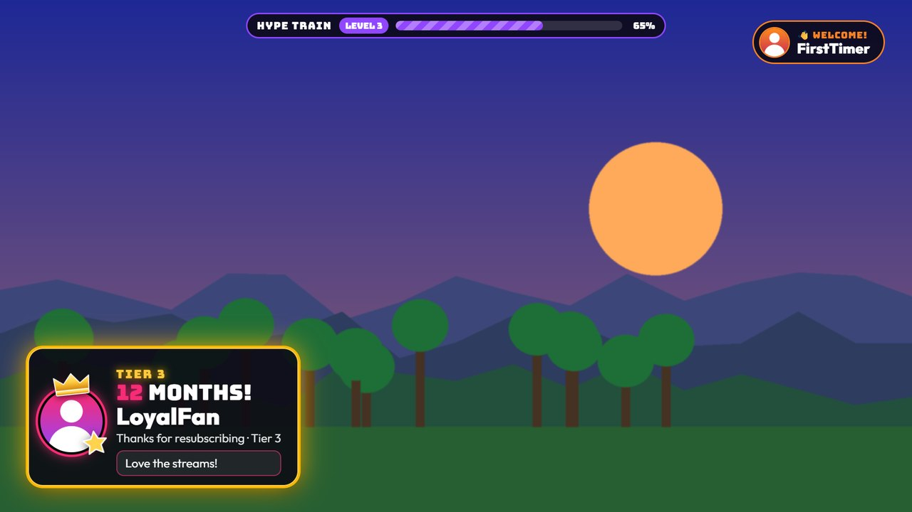

# Stream overlay (OBS)

[← Back to the README](../README.md) · [All docs](README.md)

The same alerts that play on your TV can also play on your stream, as small
see-through cards in a corner of the picture. It's the same container, the
same port and the same MixItUp URLs: there's nothing extra to install.



<sub>A made-up game scene and channel names; the cards are exactly what the overlay shows.</sub>

## Add it to OBS

1. In OBS, add a **Browser** source to your scene.
2. **URL**: `http://<server-ip>:8777/overlay` (Settings > **Stream overlay**
   has it with a copy button).
3. **Width** `1920`, **Height** `1080`. No custom CSS needed: the page is
   already transparent.
4. Turn **Shutdown source when not visible** off, so it stays connected
   when you switch scenes.
5. If you want alert audio from it (clips, see below) to go through OBS,
   tick **Control audio via OBS**.

Streamlabs Desktop and other streaming apps work the same way: any Browser
Source (or "web page" source) at 1920 x 1080.

## What it shows

- **Between alerts, nothing at all.** No logo, no background.
- **Alerts** in the size you pick for each one (see below): a compact card
  in your corner, a bigger card in the centre, or the TV's full-screen
  animation over your game. Raids are full screen by default; everything
  else is compact. They use the same words, colours, themes and pictures as
  on the TV: shoutouts, raids, follows, subs and resubs (with
  the Tier 2 and 3 styles), bits, gifted subs, watch streaks, modiversaries,
  gigantified emotes, messages and TikTok gifts. Each card stays up for a
  few seconds, then slides away.
- **First-time chatters** get a small pop-up in the opposite top corner.
- **Text to speech** ([Text to speech](tts.md)) plays here by default, with a
  small bubble showing who's being read, in the corner opposite your alerts.
- **Hype trains** show a slim progress bar along the top (or the bottom, if
  your cards are at the top), with the same start, level-up and end banners.

## It has its own queue

The TV and the overlay don't wait for each other. Each has its own queue:
while the TV is playing a raider's 30-second clip, the overlay shows the
raid card for its few seconds and goes straight on to the next alert. One
MixItUp request still plays on both, and Twitch lookups and avatar colours
are only done once.

Room lights follow the **TV** only, so an alert that only goes to the
overlay leaves your lights alone.

## Settings

Settings > **Stream overlay**:

| Setting | What it does |
| --- | --- |
| Position | Top left, top right, bottom left (default), bottom right or bottom centre. |
| Size | 0.5 to 2. `1` is about a fifth of the screen wide for a typical card. |
| Panel opacity | How see-through the card's dark panel is: 0.2 (very) to 1 (solid). Default 0.85. |
| Darken the stream behind big alerts | 0 (not at all) to 0.9. Default 0.5. Full-screen alerts darken your game by this much; centre ones by a bit over half of it. |
| Each alert (seconds) | How long Compact and Centre alerts stay up, 2 to 30. Default 6. Full-screen alerts keep the TV's timings (a raid's 12 seconds, for example). |
| Stream overlay: play a clip after shoutouts and raids | The overlay's own switch, separate from the TV's. Off by default, so a clip's sound doesn't play twice (once from the TV in your room, once on stream). When on, a full-screen alert's clip plays full screen; the others in a small player. |

The **Live preview** at the top of the settings page has a **TV / Stream
overlay** switch. The overlay preview sits on a stand-in game scene so you
can see what's see-through.

## Choose how big each alert is

Next to each alert in **Where each alert plays** is its **Size on stream**:

| Size | What it looks like |
| --- | --- |
| Compact | A small card in your corner. Your game stays clear. |
| Centre | A bigger card in the middle of the screen, the stream a little darker behind it. |
| Full screen | The TV's own animation (the raid portal, the Tier 3 crown and coins, the follow hearts…) over your game, the stream darkened behind it. |

Full-screen alerts are played by the TV page itself, see-through, inside the
overlay, so they always look exactly like the TV. The stream behind them is
**darkened**, not blurred: a Browser Source can only draw on top of your
other sources, it can't see (or blur) them. If you want real blur, OBS can
do it with a blur filter on your game source.

## Choose where each alert plays

Settings > **Stream overlay > Where each alert plays** has a choice for
every alert type: **TV only**, **Overlay only** or **Both**. Everything
plays on both by default, except gigantified emotes, which stay on the TV
(a giant emote over your game is a lot).

One alert can override it from its URL with `&screen=tv`, `&screen=overlay`
or `&screen=both`, for example a MixItUp command that only puts a message on
stream:

```
http://<server-ip>:8777/message?text=$allargs&from=$username&screen=overlay
```

`/logo` clears both screens; `/logo?screen=overlay` or `/logo?screen=tv`
clears just one. The test buttons on the settings page have a **Send tests
to** picker for the same choice.

## Tips

- **More than one scene?** Add the same Browser Source to each scene (or
  use one source as a "nested scene"). Every open overlay page shows the
  same alert at the same time.
- **Lite mode**: `/overlay?mode=lite` drops the glows and blurs, the same as
  on the TV. OBS rarely needs it.
- **Nothing shows up**: open the overlay address in a normal browser and
  press **Test follow** on the settings page with **Send tests to** set to
  **Stream overlay only**. The chip at the top of the settings page counts
  connected overlays.
